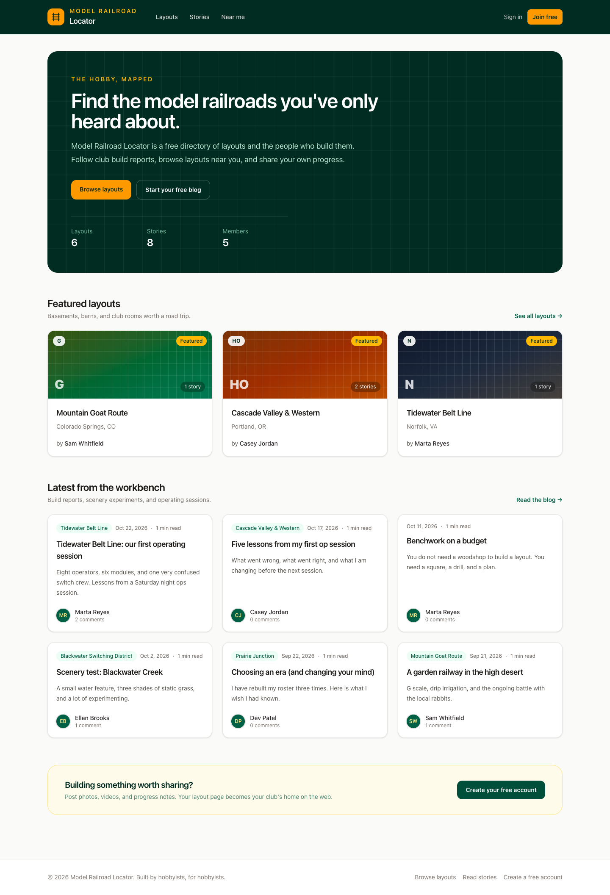
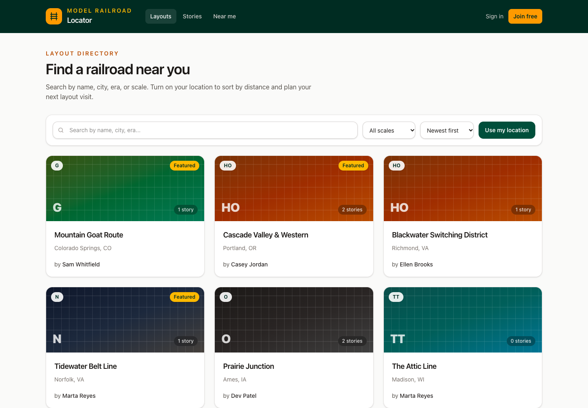
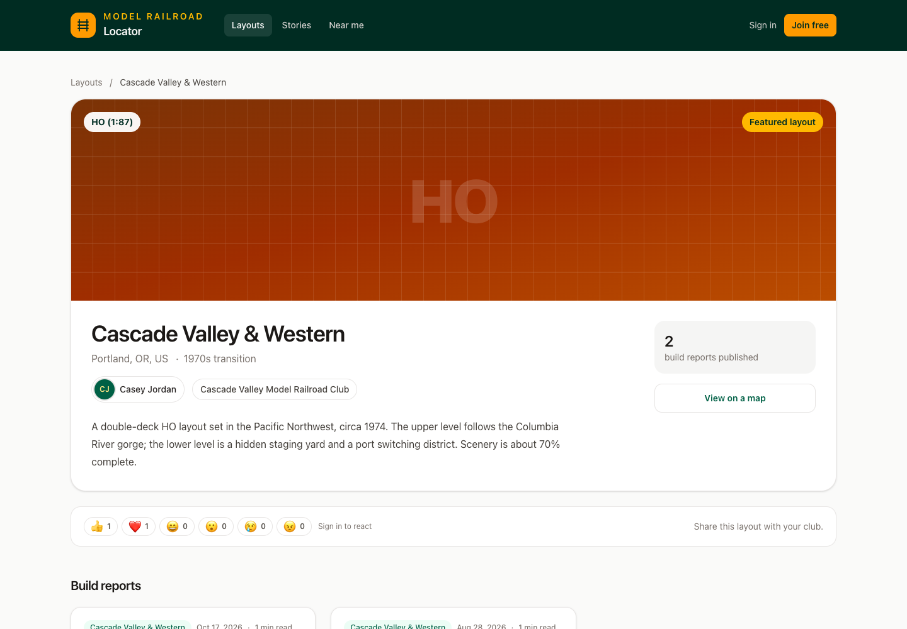
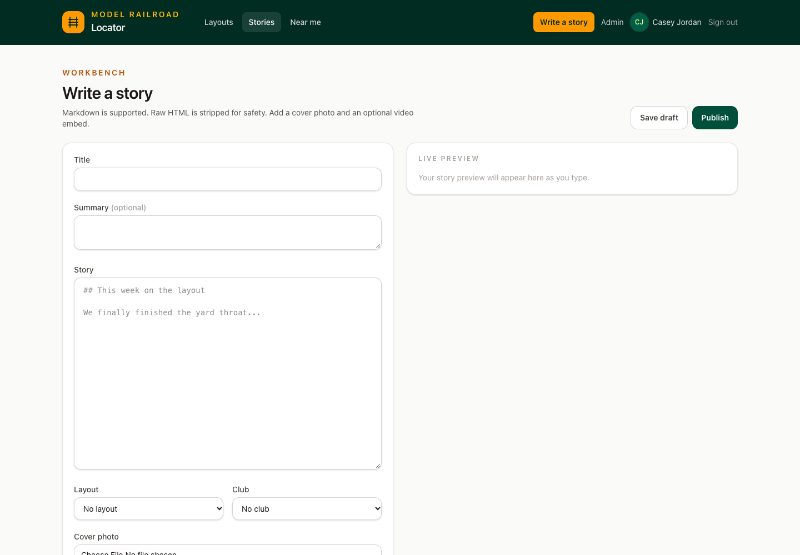
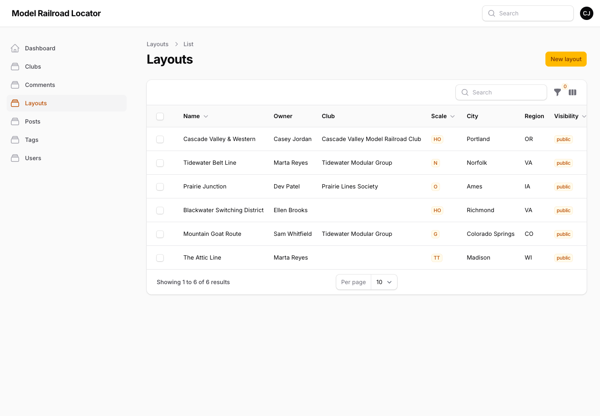

# Model Railroad Locator

A free directory and member-blog platform for model railroad layouts. Members list their
railroads, publish build reports with photos and video embeds, and the community browses,
searches, comments, and reacts.

Built with **Laravel 13**, **Livewire 4**, **Filament 5**, **Tailwind CSS 4**, and **SQLite**
for local development (Postgres recommended in production).

<p align="center">
  <a href="docs/screenshots/01-home.png">
    
  </a>
</p>

## Screenies

| Layout directory | Layout detail |
| --- | --- |
|  |  |

| Story editor | Admin panel |
| --- | --- |
|  |  |

All captures in [`docs/screenshots/`](docs/screenshots):

- [Home](docs/screenshots/01-home.png)
- [Layout directory](docs/screenshots/02-layouts.png)
- [Layout detail](docs/screenshots/03-layout-detail.png)
- [Blog index](docs/screenshots/04-blog-index.png)
- [Blog post](docs/screenshots/05-blog-post.png)
- [Member profile](docs/screenshots/06-member-profile.png)
- [Club page](docs/screenshots/07-club-page.png)
- [Story editor](docs/screenshots/08-post-editor.png)
- [Layout editor](docs/screenshots/09-layout-editor.png)
- [Admin panel](docs/screenshots/10-admin-panel.png)
- [Mobile home](docs/screenshots/11-home-mobile.png)

## What is included

- **Layout directory** with search, scale filters, an interactive Leaflet/OpenStreetMap map,
  viewport-aware markers, and "sort by distance" using a portable haversine query (no PostGIS
  required to run locally). Distances default to miles with a kilometre toggle.
- **Member blogs** with a Markdown editor, live preview, draft/publish workflow, cover photos,
  and optional video embeds.
- **Clubs** with memberships, club pages, layouts, and stories.
- **Follows and notifications** — follow layouts, clubs, and members, get in-app notifications for
  comments and replies, and receive a weekly email digest of new stories from the railroads you
  follow. Queued notifications are delivered by the queue worker; the digest runs on the scheduler.
- **Comments** with one level of replies, author/moderation deletion, and soft deletes.
- **Reactions** (like, love, haha, wow, sad, angry) with one reaction per member per item.
- **Profiles** at `/members/{username}` showing each member's layouts and stories.
- **Admin panel** at `/admin` (Filament) for users, layouts, posts, clubs, comments, and tags.
- **Demo seed data** with six layouts, eight stories, members, clubs, comments, and reactions.

## Requirements

- PHP 8.3+ with the usual Laravel extensions
- Composer
- Node.js 20+ and npm
- SQLite (default) or Postgres for production

## Setup

```bash
composer install
npm install

cp .env.example .env
php artisan key:generate

touch database/database.sqlite
php artisan migrate --seed
php artisan storage:link

npm run build
php artisan serve
```

Then open <http://localhost:8000>.

### Demo accounts

These accounts are created only for the local development database by `php artisan migrate --seed`, and are for the dev site only. Do not use them in production.

| Role | Name | Email | Password |
| --- | --- | --- | --- |
| Admin | Casey Jordan | `admin@example.com` | `password` |
| Member | Marta Reyes | `marta@example.com` | `password` |
| Member | Dev Patel | `dev@example.com` | `password` |
| Member | Ellen Brooks | `ellen@example.com` | `password` |
| Member | Sam Whitfield | `sam@example.com` | `password` |

The admin account can access `/admin`. Every seeded member uses `password`.

## Routes

| Path | Purpose |
| --- | --- |
| `/` | Home, featured layouts, latest stories |
| `/layouts` | Searchable layout directory |
| `/layouts/{slug}` | Layout detail, build reports, reactions, comments |
| `/blog` | All published stories with search |
| `/blog/{slug}` | Story detail, reactions, comments |
| `/members/{username}` | Member profile, layouts, stories |
| `/clubs/{slug}` | Club page, members, layouts, stories |
| `/account/notifications` | Notification inbox (auth) |
| `/account/notifications/preferences` | Email notification preferences (auth) |
| `/account/profile` | Edit own profile, avatar, and location (auth) |
| `/notifications/unsubscribe/{user}/{type}` | One-click unsubscribe from a signed email link |
| `/forgot-password` | Request a password reset email (guest) |
| `/reset-password/{token}` | Reset password with a token (guest) |
| `/stories/new` | Write a story (auth) |
| `/stories/{post}/edit` | Edit a story (auth, owner or admin) |
| `/layouts/new` | Add a layout (auth) |
| `/layouts/{layout}/edit` | Edit a layout (auth, owner or admin) |
| `/admin` | Filament admin panel (admins only) |

## Data model

```
User ──< ClubMembership >── Club
 │                            │
 ├──< Layout >────────────────┘
 │      │
 │      └──< Post >──< Comment (morph, 1-level replies)
 │             │
 │             ├──< Media (morph: image or video_embed)
 │             ├──< Reaction (morph, unique per user)
 │             └──< Tag (morph to many)
 └──< Post
```

Key migrations live in `database/migrations`. Enums (`LayoutScale`, `LayoutVisibility`,
`PostStatus`, `ReactionType`, `MembershipRole`) live in `app/`.

Follows are polymorphic (`followable_type` / `followable_id`), so a member can follow a
`Layout`, `Club`, or another `User` with one table. Notifications use Laravel's standard
`notifications` table, and each member has opt-out flags plus a `digest_sent_at` watermark
for the weekly digest.

### Account

- The header links to `/account/profile`, a Livewire page where members edit their display
  name, bio, location, and avatar. Avatars upload to the `public` disk under `avatars`.
- Password reset uses the framework broker: `POST /forgot-password` sends a `ResetPassword`
  notification, and `POST /reset-password` validates the token, updates the password, and
  signs the member back in.

## Architecture notes

### Search

MVP search uses `LIKE` queries scoped through model scopes (`Layout::search()`,
`Post::search()`). When the directory grows, install Laravel Scout with Meilisearch or
Typesense and move these scopes to `searchableAs()` / `toSearchableArray()`.

### Distance search and maps

`Layout::scopeNear()` uses the haversine formula in SQL. It works on SQLite, MySQL, and
Postgres today. The directory map is Leaflet with OpenStreetMap tiles (no API key), fed by
the same filters as the list. The map asks the server for markers inside its visible bounds
(`Layout::scopeWithinBounds()`) so marker payloads stay small.

Precise geolocation requires HTTPS (or `localhost`). When the browser will not share a
location, the map falls back to a coarse IP-based center from [ipinfo.io](https://ipinfo.io)
(with [ipwho.is](https://ipwho.is) as a fallback) so it still opens near the visitor's area;
a US-wide view is the final fallback. The approximate lookup is cached in `sessionStorage`
and is never used for the distance sort unless the visitor picks "Use my location" first. For large datasets, switch to PostGIS:

```sql
-- Add to the layouts migration on Postgres
ALTER TABLE layouts ADD COLUMN location geography(Point, 4326);
CREATE INDEX layouts_location_idx ON layouts USING GIST (location);
```

Then replace the scope with `ST_DWithin(location, ST_MakePoint(?, ?)::geography, ?)`.

### Media

- Images are uploaded to the `public` disk (`storage/app/public`) and served through
  `php artisan storage:link`.
- Video is intentionally **embed-only** (YouTube/Vimeo). Self-hosted video is the biggest
  cost risk for a free site; move to Cloudflare Stream or Mux only when there is revenue.
- For production, point the `public` disk at Cloudflare R2 or S3 and add queued image
  resizing (e.g. `intervention/image`) so uploads never block a request.

### Auth and permissions

- Session auth with registration, login (rate limited), and logout.
- `Gate::before()` grants admins all abilities for moderation.
- Policies: `PostPolicy`, `LayoutPolicy`, `CommentPolicy` (owners can edit/delete; admins
  can moderate).
- Filament access is restricted by `User::canAccessPanel()`, which requires `is_admin`.

### Follows and notifications

- `App\Models\Concerns\Followable` gives `Layout`, `Club`, and `User` a `followers()` relation
  and an `isFollowedBy()` helper. `FollowButton` toggles follows from any of those pages.
- `CommentObserver` sends a `NewCommentNotification` to the content owner and a
  `ReplyNotification` to the parent comment author. It never notifies the commenter about
  their own comment, and it de-duplicates when the owner and parent author are the same person.
- Notifications implement `ShouldQueue` and use the `database` + `mail` channels, so they run
  on the queue worker. Each member can turn off the email channel while keeping in-app
  notifications; email links include a signed one-click unsubscribe route.
- `php artisan notifications:follow-digest` gathers published stories since each member's
  `digest_sent_at` watermark and sends one `FollowDigestNotification` per member. It is
  scheduled weekly (Mondays at 08:00) in `routes/console.php`.
- The in-app inbox marks notifications read on visit, and the header bell polls once a minute.

Run the digest manually with:

```bash
php artisan notifications:follow-digest
```

## Testing

```bash
php artisan test
```

The suite covers public pages, layout browsing/filtering/distance, story creation,
draft visibility, comments, reactions, layout creation, follows, notifications, profile
editing, password reset, authorization, admin panel, and auth.

## Production checklist

- [ ] Set `APP_VERSION` on each deploy so the footer shows which build is live.
- [ ] Switch to Postgres, add PostGIS if you want indexed geo queries.
- [ ] Move media to R2/S3 and process images in a queue.
- [ ] Run `php artisan queue:work` (or Horizon) for uploads, mail, and queued notifications.
- [ ] Run the scheduler (`php artisan schedule:work`, or a cron entry for `schedule:run`) so the
      weekly follow digest goes out.
- [ ] Add email verification, report/flag workflows, spam protection, and a DMCA agent.
- [ ] Add Terms of Service, privacy policy, and a content policy.
- [ ] Configure backups and monitoring.
- [ ] Add advertising/sponsorship inventory (Stripe + simple ad-slot tables) and, later,
      classifieds and swap-meet listings built on the same geo/media primitives.

## Not built yet

Email verification, report/flag workflows, native apps, ad serving, classifieds, and swap
meets. The schema and policies are designed so those can be added without reworking the core.
